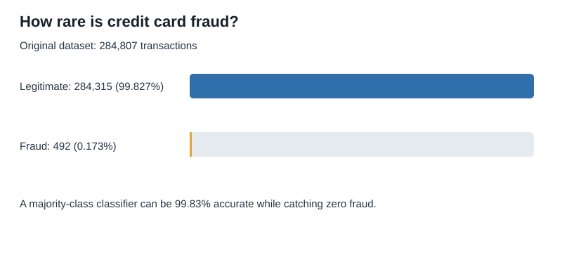

# Credit Card Fraud Detection Using Machine Learning

A reproducible CRISP-DM project comparing Logistic Regression and Random Forest for highly imbalanced fraud classification.

## Motivation and research questions

Fraudulent credit card transactions are rare. Can statistical learning identify fraud while keeping false alerts manageable?

1. How rare is fraud?
2. How do transaction amounts differ between legitimate and fraudulent purchases?
3. How do two machine-learning models compare on recall, precision, F1 and average precision?
4. What does a held-out transaction prediction demonstrate?

## Source dataset and cleaning

[ULB/Worldline Credit Card Fraud Detection (Kaggle)](https://www.kaggle.com/datasets/mlg-ulb/creditcardfraud). Original dataset: **284,807 transactions** including **492 frauds (0.173%)**. There are **no missing values**, but **1,081 exact duplicate rows**. After deduplication, **283,726 rows** remain, including 473 fraud cases.

The original `creditcard.csv` is **not committed** to this repository due to its size. Download it from Kaggle and save it as `data/creditcard.csv`.

## Methods

CRISP-DM phases: (1) business understanding; (2) EDA; (3) data cleaning and preparation; (4) modeling; (5) evaluation; (6) held-out transaction scoring as a deployment demonstration.

- Stratified train/test split: 80%/20%, `random_state=42`.
- Training: 226,980 rows; held-out testing: 56,746 rows, including 95 fraud cases.
- Logistic Regression: class weights balanced; StandardScaler fitted on training data only.
- Random Forest: 60 trees; minimum leaf size 2; balanced-subset class weights.
- Default decision threshold used; no threshold optimization on the test set.

## Verified results

| Model | Accuracy | Precision | Recall | F1 | Avg. precision (AP) | Fraud caught | False alerts |
|---|---:|---:|---:|---:|---:|---:|---:|
| Logistic Regression | 97.531% | 5.639% | 87.368% | 0.1059 | 0.6719 | 83/95 | 1,389 |
| Random Forest | 99.951% | 97.183% | 72.632% | 0.8313 | 0.8081 | 69/95 | 2 |

**Interpretation:** Logistic Regression had higher recall but far more false alerts at the default threshold. Random Forest achieved higher precision and average precision, but missed 26 of the 95 frauds. Neither model is suitable for deployment without cost-sensitive analysis and further validation. 




## Repository contents

- `notebooks/fraud_detection_analysis.ipynb`: executable CRISP-DM notebook with comments.
- `requirements.txt`: Python dependencies.
- `data/README.md`: dataset instructions.
- `images/`: checked-in SVG summaries; execution also generates PNG EDA and model charts.
- `blog/fraud_detection_article.md`: 200–500-word Medium article draft using measured results.
- `.github/workflows/notebook-check.yml`: validates notebook structure, not model results.

## Running the project

```bash
python -m pip install -r requirements.txt
cd notebooks
jupyter lab
```

Open `fraud_detection_analysis.ipynb` and run all cells. The notebook loads `../data/creditcard.csv` and saves generated figures to `../images/`.

## Limitations and acknowledgments

This research uses historical, anonymized data including PCA-transformed variables V1–V28; such components cannot be interpreted as specific merchant/customer behaviors. A single random holdout does not test temporal drift. Model scores are not calibrated probabilities. Deployment would require temporal validation, calibrated thresholds, review costs, fairness/privacy assessment, ongoing monitoring, and human oversight.

Dataset: ULB Machine Learning Group and Worldline, shared through Kaggle. Tools: Python, pandas, NumPy, scikit-learn, Matplotlib, Seaborn and Jupyter. Article publication pending at [Medium](https://medium.com/@ayobamiawogboro123).

## Course project submission

- **[GitHub project](https://github.com/ayoawo123/credit-card-fraud-detection-ml)**
- **[Published Medium article: 99.83% Accurate. Zero Fraud Caught. Here's the Catch.](https://medium.com/@ayobamiawogboro123/99-83-accurate-zero-fraud-caught-heres-the-catch-4723a7b49b1c)**
- **[Rubric-based submission summary](SUBMISSION.md)**

The notebook now explicitly asks and answers **four business questions** and uses documented reusable functions with docstrings. All five required libraries are declared in `requirements.txt`.
